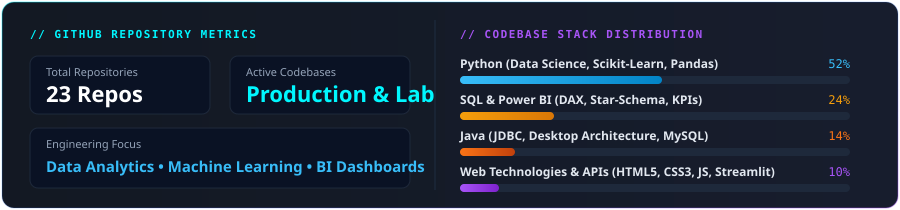

#### 🏢 Business Analyst Intern &bull; Unified Mentor Pvt. Ltd.
*June 2025 &ndash; July 2025*
- Formulated structured data models to identify commercial trendlines and guide data-backed executive recommendations.
- Prepared comprehensive analytical presentations, requirement documentation, and KPI tracking frameworks.
- Bridged the communication gap between operational workflows and analytical findings to accelerate data-informed decisions.

#### 🏭 Industrial Operations &bull; Om Chamunda Enterprises Pvt. Ltd.
*Family Enterprise Engagement &ndash; Packaging &amp; Plastic-Processing Machinery Manufacturing*
- Practical exposure to machinery manufacturing, supply chain dynamics, and vendor delivery schedules.
- Analyzed production workflow bottlenecks, inventory holding metrics, and raw material cost sensitivity.
- Grounded computer science principles in tangible industrial business problems and physical product economics.

#### 🌱 Green Intern &bull; 1M1B Foundation (One Million for One Billion)
*Youth Leadership &amp; Sustainable Development Program*
- Coordinated youth sustainability initiatives, public awareness workshops, and resource tracking metrics in alignment with UN Sustainable Development Goals (SDGs).

 

<b>📜 Verified Industry Certifications &amp; Credentials</b>

 

- 🛡️ **AI Skills Passport** &ndash; *EY and Microsoft Verified*
- 🤖 **Generative AI: Prompt Engineering Basics** &ndash; *Microsoft / LinkedIn*
- 🧠 **Foundations of Machine Learning** &ndash; *Data Science Specialization*
- 🗄️ **MongoDB Database Administrator Path** &ndash; *MongoDB University*
- 📊 **Business Analyst Internship Certificate** &ndash; *Unified Mentor Pvt. Ltd.*

 

 

<!-- SECTION 05: GITHUB TELEMETRY -->

 

<!-- CUSTOM VERIFIED TELEMETRY CARD -->

  

<!-- DYNAMIC ACTIVITY STREAK -->

  

<!-- REAL-TIME INSPIRATION QUOTE -->

 

 

<!-- SECTION 06: CONNECT -->

 

  <b>Actively exploring Internship, Graduate &amp; Full-Time opportunities across:</b> 
  <code>Data Analytics</code> &bull; <code>Business Intelligence</code> &bull; <code>Machine Learning</code> &bull; <code>Data Science</code> &bull; <code>Business Analytics</code>

  
  &nbsp;&nbsp;
  
  &nbsp;&nbsp;
  
  &nbsp;&nbsp;
  

 
