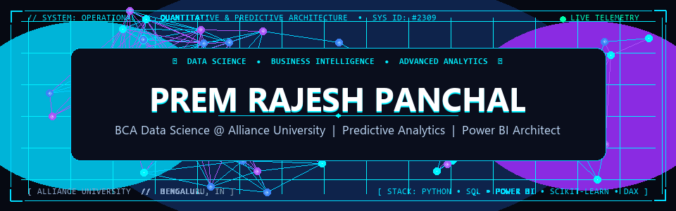
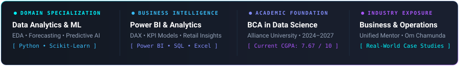

<div align="center">

<!-- CINEMATIC ANIMATED HERO HEADER -->
<a href="https://github.com/Prem2309">
  
</a>

<br/>

<!-- INTERACTIVE EXECUTIVE CONTROL BAR -->
<p align="center">
  <a href="https://premdashboards.netlify.app/" target="_blank">
    
  </a>
  &nbsp;
  <a href="https://www.linkedin.com/in/prem-panchal-702230258/" target="_blank">
    
  </a>
  &nbsp;
  <a href="assets/Prem_Panchal_Resume.pdf" target="_blank">
    
  </a>
  &nbsp;
  <a href="mailto:prempanchal822@gmail.com">
    
  </a>
  &nbsp;
  <a href="https://github.com/Prem2309">
    
  </a>
</p>

<!-- HUD TELEMETRY OVERVIEW MATRIX -->


<br/>


</div>

<br/>

<!-- SECTION 01: ARCHITECTURE & PHILOSOPHY -->


<br/>

```python
class QuantitativeDataScientist:
    """
    Profile: Prem Rajesh Panchal
    Academic: BCA in Data Science | Alliance University, Bengaluru (2024 - 2027)
    Philosophy: Bridging Data Analysis, Business Understanding & Software Engineering
    """
    def __init__(self):
        self.specializations = [
            "Predictive Machine Learning & Algorithmic Modeling",
            "Executive Business Intelligence & Star-Schema DAX Architecture",
            "Industrial Supply-Chain & Operational Telemetry Analytics",
            "Exploratory Data Analysis (EDA) & Statistical Inference"
        ]
        self.commercial_dna = (
            "Family industrial machinery background (Om Chamunda Enterprises) "
            "+ Business Analysis rigor (Unified Mentor)"
        )

    def solve_problem(self, raw_telemetry: Dataset) -> BusinessValue:
        clean_pipeline = self.audit_integrity_and_eda(raw_telemetry)
        predictive_model = self.train_optimized_models(clean_pipeline)
        executive_kpi = self.build_power_bi_interactive_drillthrough(predictive_model)
        return executive_kpi.deliver_measurable_roi()
```

- 🎓 **Undergraduate Specialization:** Pursuing **BCA in Data Science** at **Alliance University**, Bengaluru (*Current CGPA: 7.67 / 10*).
- 🧠 **Commercial Problem Solving:** Unlike purely theoretical practitioners, I ground analytics in actual business operations, inventory flows, and cost sensitivity developed through family enterprise exposure at **Om Chamunda Enterprises Pvt. Ltd.** (packaging & plastic-processing machinery).
- 📊 **BI & DAX Architecture:** Architecting end-to-end interactive intelligence dashboards on **Microsoft Power BI** and **Excel** using robust Star-Schema models and dynamic DAX measures.
- 🤖 **Predictive Modeling & AI:** Building supervised and unsupervised pipelines (*Scikit-Learn, Random Forests, KNN, Decision Trees, Regression*) focused on real-world forecasting and classification.
- 🌐 **Live Ecosystem:** Interactive projects and live dashboard deployments available at **[premdashboards.netlify.app](https://premdashboards.netlify.app/)**.

<br/>

<br/>

<!-- SECTION 02: TECHNICAL ECOSYSTEM -->


<br/>

<div align="center">
  <!-- Interactive Tech Icons Grid -->
  <a href="https://skillicons.dev">
    
  </a>
</div>

<br/>

<details open>
<summary><b>🔍 EXPLORE DETAILED TECHNOLOGY ECOSYSTEM &amp; FRAMEWORKS</b></summary>
<br/>

| Domain Layer | Applied Frameworks &amp; Technologies | Production Competencies |
| :--- | :--- | :--- |
| **🧠 Machine Learning &amp; AI** | `Python` `Scikit-Learn` `Pandas` `NumPy` `Matplotlib` `Seaborn` | Exploratory Data Analysis (EDA), Hyperparameter Tuning, Classification (*KNN, Random Forest, Decision Trees*), Regression, Feature Scaling, ROC-AUC Evaluation |
| **📊 Business Intelligence &amp; Analytics** | `Microsoft Power BI` `DAX` `Microsoft Excel (Advanced)` | Star-Schema Modeling, Time-Intelligence DAX, Pareto 80/20 Analysis, YoY Growth Metrics, Executive KPI Scorecards, Dynamic Drill-Downs |
| **🗄️ Relational &amp; Document Databases** | `SQL (MySQL)` `MongoDB` `JDBC` | Relational Schema Design, Database Normalization (1NF–3NF), Complex Multi-Table Joins, ACID Transaction Safeguards, Aggregation Pipelines |
| **💻 Software Engineering &amp; Core** | `Python` `Java` `HTML5` `CSS3` `JavaScript` `Streamlit` | OOP Principles, Desktop Application Architecture, RESTful API Integration, Interactive Web Interfaces, Data Structures &amp; Algorithms |
| **⚙️ Developer Toolchain &amp; DevOps** | `Git` `GitHub` `VS Code` `Jupyter Notebook` `Netlify` `Vercel` | Version Control, GitHub Actions Workflow Automation, CI/CD Cloud Deployments, Virtual Environments |

</details>

<br/>

<br/>

<!-- SECTION 03: FEATURED REPOSITORIES -->


<br/>

### 01 // QUANTITATIVE FINANCE & MACHINE LEARNING
<a href="https://github.com/Prem2309/Stock_Portfolio_Management_System">
  
</a>

<details open>
<summary><b>Technical Architecture &amp; Key Features</b></summary>
<br/>

- **Problem Addressed:** Volatility and unhedged risk exposure often compromise retail stock investments due to lack of systematic quantitative rebalancing.
- **Engineered Solution:** Developed a full-cycle quantitative portfolio analytics engine that ingests historical market datasets, computes risk-return dynamics (Sharpe ratio, beta, maximum drawdown), and applies predictive machine learning algorithms to model price trajectory.
- **Stack:** `Python` • `Pandas` • `NumPy` • `Scikit-Learn` • `Matplotlib` • `Predictive Analytics`
- **Direct Repository:** [Prem2309/Stock_Portfolio_Management_System](https://github.com/Prem2309/Stock_Portfolio_Management_System)
</details>

<br/>

### 02 // NATURAL LANGUAGE PROCESSING & CONVERSATIONAL AI
<a href="https://github.com/Prem2309/SELF-CTRL-AI-">
  
</a>

<details open>
<summary><b>Technical Architecture &amp; Key Features</b></summary>
<br/>

- **Problem Addressed:** Standard conversational bots deliver impersonal answers and fail to analyze human emotional distress or psychological problem dimensions.
- **Engineered Solution:** Engineered an empathetic dialog agent utilizing NLP sentiment analysis and context decomposition pipelines to parse user inputs, deconstruct stressors, and offer guided, cognitive problem-solving paths.
- **Stack:** `Python` • `NLP Pipelines` • `Streamlit` • `Sentiment Analysis` • `REST APIs`
- **Direct Repository:** [Prem2309/SELF-CTRL-AI-](https://github.com/Prem2309/SELF-CTRL-AI-)
</details>

<br/>

### 03 // EXECUTIVE BUSINESS INTELLIGENCE & DATA MODELING
<a href="https://premdashboards.netlify.app/">
  
</a>

<details open>
<summary><b>Technical Architecture &amp; Key Features</b></summary>
<br/>

- **Problem Addressed:** Distributed transactional retail sales data leaves leadership blind to real-time inventory turnover bottlenecks and customer lifetime profitability.
- **Engineered Solution:** Implemented an enterprise Star-Schema relational model connected to Power BI and SQL, featuring dynamic DAX measures for YoY performance, product margin elasticity, and regional performance drill-downs.
- **Stack:** `Microsoft Power BI` • `SQL (MySQL)` • `DAX Measures` • `Microsoft Excel` • `Star-Schema`
- **Live Interactive Dashboard:** [premdashboards.netlify.app](https://premdashboards.netlify.app/)
- **Direct Repository:** [Prem2309/Business-Analytics-Projects](https://github.com/Prem2309/Business-Analytics-Projects)
</details>

<br/>

<details>
<summary><b>📚 Additional Production &amp; Academic Codebases</b></summary>
<br/>

| Repository | Focus &amp; Core Stack | Architecture Highlights |
| :--- | :--- | :--- |
| **[Student-Database-Management-System](https://github.com/Prem2309/Student-Database-Management-System)** | `Java` `MySQL` `JDBC` | Full-stack desktop relational database interface with ACID compliance, constraint validations, and administrative CRUD workflows. |
| **[DATA-SCIENCE](https://github.com/Prem2309/DATA-SCIENCE)** | `Python` `Scikit-Learn` `EDA` | Comprehensive data preprocessing, statistical validation, classification models, and predictive algorithms. |
| **[City-Saathi-](https://github.com/Prem2309/City-Saathi-)** | `JavaScript` `Web Architecture` | Civic assistance and urban services discovery platform tailored for smart city navigation. |

</details>

<br/>

<br/>

<!-- SECTION 04: PROFESSIONAL EXPERIENCE -->


<br/>
